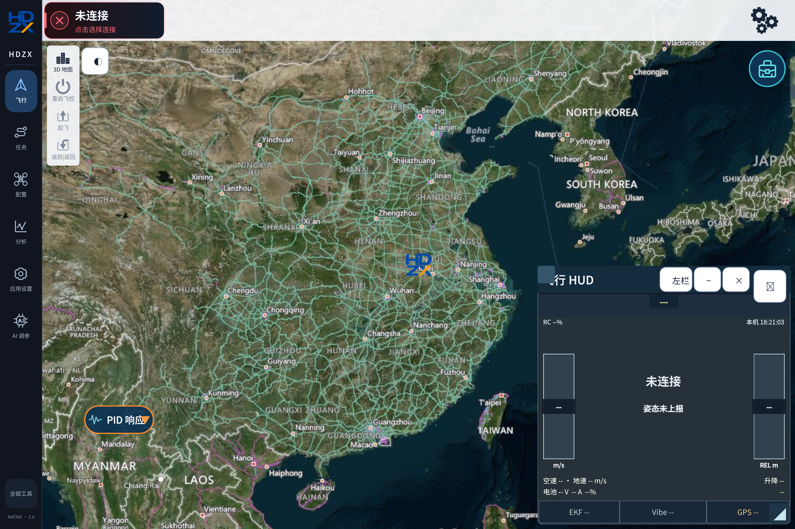

# HDZX Android · Open-source Release

[中文](README.md) · **English** · [Download APK](https://github.com/duan816/HDZX-Android/releases/tag/v2.0.33)

An Android ground station for **ArduPilot and PX4**, built on [QGroundControl](https://github.com/mavlink/qgroundcontrol) and maintained independently by 段中旭工作室 (Duan Zhongxu Studio). This is not an official QGroundControl release.

HDZX brings flight monitoring, a classic HUD, manual mission planning, PID response plots, parameter tuning and log analysis to phones and tablets. Its custom interface is primarily Chinese; English documentation does not imply that every custom panel is translated.

## Screenshots and interface guide

See the [screenshot gallery](docs/SCREENSHOTS.md) for device captures and descriptions. Screens without a connected flight controller show unavailable values rather than fabricated telemetry.

## Features

| Area | What it provides |
|---|---|
| Connections | Manual MAVLink connections over supported USB/serial, UDP and TCP links. USB support depends on the Android device and driver. |
| Flight view | Mode, position, battery, altitude, speed, link status, flight tracks and Home markers; 2D maps and 3D terrain where supported by the data source and network. |
| Classic HUD | Attitude, heading, GNSS fix status, EKF and vibration diagnostics; movable, resizable and collapsible panels. |
| Mission planning | Manual waypoints, mission file import/export and preview. Check coordinates, altitude reference and mission content before uploading. |
| PID response | Rate, attitude, position and velocity loops, axis selection, selectable update rates and available curves. Targets and PID components require actual firmware telemetry. |
| Extended tuning | Grouped parameters exposed by the connected firmware, preview and confirmation before submission, plus the original parameter table. |
| Peripheral setup | Parameter suggestions for supported GNSS, optical flow, rangefinders and receivers. Installation offsets must be measured for the real installation. |
| Warnings and speech | Original flight-controller messages, available Chinese translations, explanations and remedies, recorded Chinese/English prompts, mode and RTK transitions. Uncatalogued messages retain their original text. |
| Logs and analysis | Log viewing and assisted analysis. AI features require your own service configuration and send selected content to that service. |
| Mobile controls | Phone/tablet scaling, touch navigation and adjustable virtual joystick size. |

Features depend on the flight controller, firmware, telemetry, peripherals and build configuration. Assisted analysis does not replace pilot judgment.

## Install

Download the signed **arm64-v8a APK** from [Releases](https://github.com/duan816/HDZX-Android/releases). Android **9 / API 28 or newer** is required. The application ID is `org.hquavcenter.hdzx.opensource`, with application data separate from other editions.

1. Install the APK and select the phone/tablet display preset on first launch.
2. For USB, use an OTG-capable device and grant USB access when requested.
3. Choose a supported connection in the application. Configure map services and analysis credentials as needed.
4. Review warnings and parameter changes before operating the vehicle.

**2.0.33** fixes a startup exit caused by missing QML type registration. It was installed on a TB711FU tablet; startup was observed, and the user confirmed that the main view and page switching no longer exited. This is not a flight-validation claim.

## Build and contribute

See [Android build instructions](docs/BUILD_ANDROID.md), [contribution guidelines](CONTRIBUTING.md) and [development rules](AGENTS.md). This repository contains the source and resources for this Android release. It does not contain signing keys, personal configuration or service credentials.

## Attribution, license and branding

- Upstream: **QGroundControl**. Preserve its authorship, copyright and license notices; see [upstream licensing](.github/COPYING.md).
- HDZX additions and changes are published under **GNU GPL v3**; this combined distribution selects GPLv3. See [LICENSE](LICENSE), [NOTICE](NOTICE), [provenance](docs/PROVENANCE.md) and [third-party dependencies](docs/THIRD_PARTY.md). Third-party files retain their own licenses.
- Modification, redistribution and commercial use are permitted under the applicable licenses. Fulfil their source-distribution, copyright, license-notice and modification-notice requirements.
- HDZX names and logos identify the official maintainer's release. Clearly identify derivatives and their maintainers; do not imply official endorsement. [Branding rules](BRANDING.md) do not add non-commercial or no-derivatives restrictions to the code license.

## Report issues

Use [GitHub Issues](https://github.com/duan816/HDZX-Android/issues). Include your device, Android and app versions, flight-controller/firmware details, and reproduction steps. Remove private coordinates, mission data and credentials before sharing logs.

