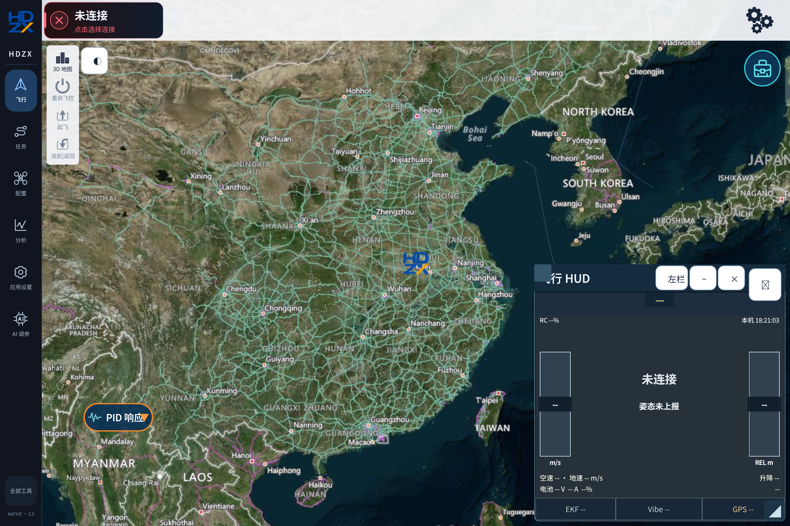
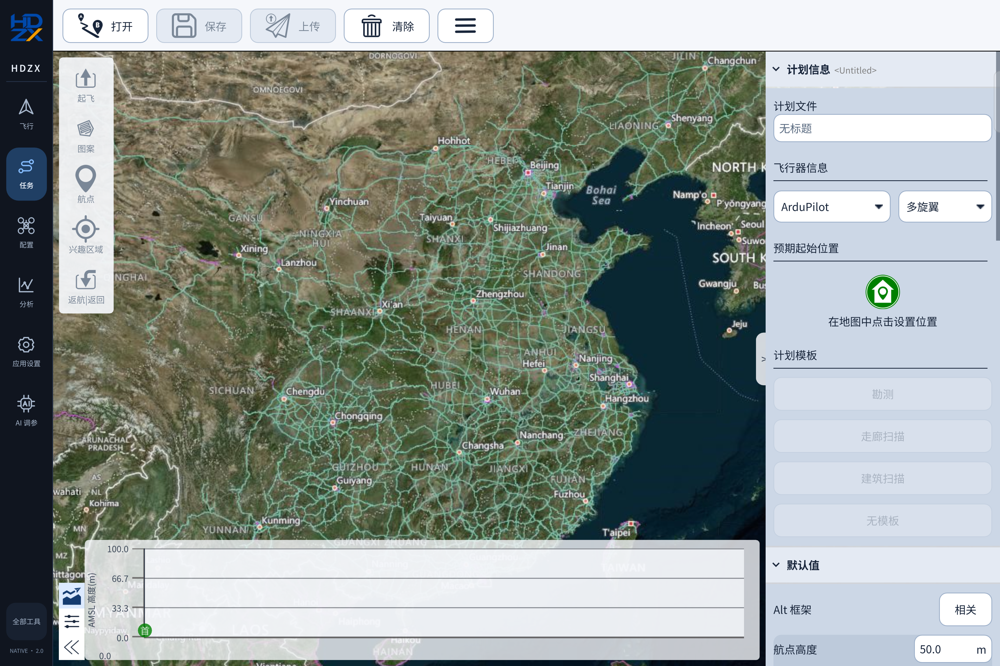
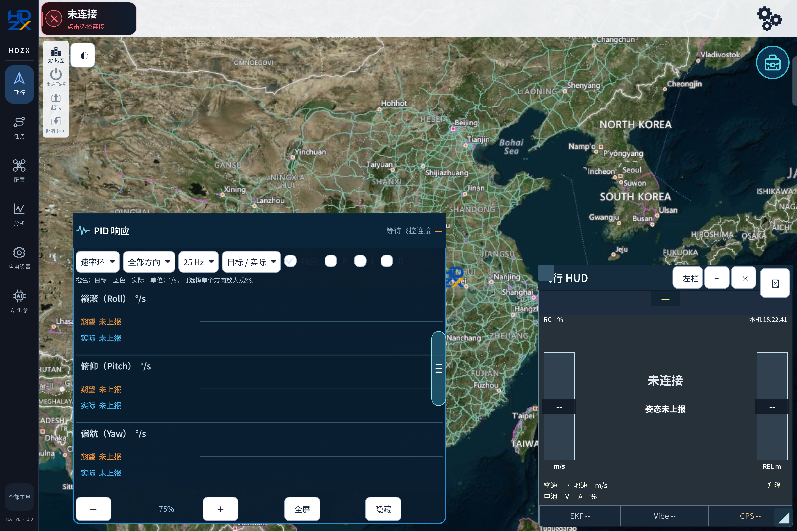
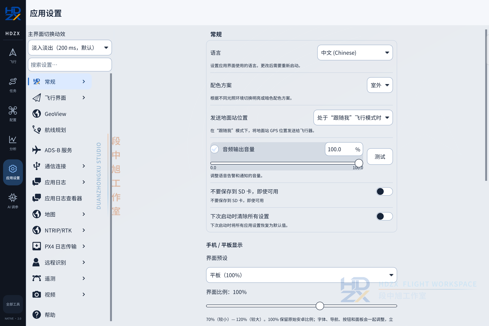
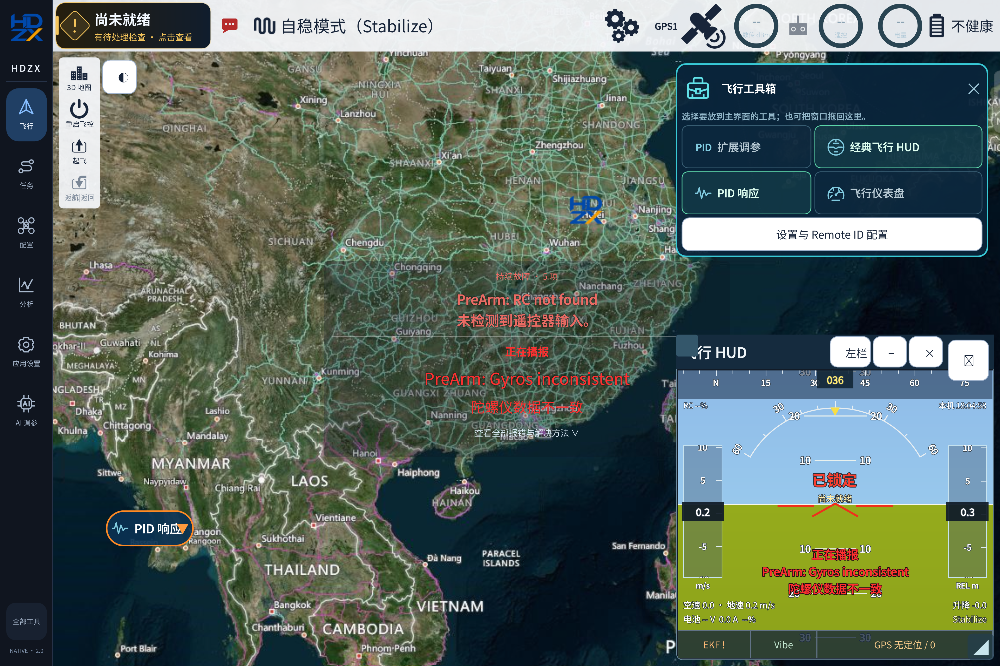

# 界面图册 / Interface gallery

[中文介绍](../README.md) · [English overview](../README.en.md)

以下四张图片由 TB711FU 平板运行开源发布版 **2.0.33** 实际截取，未连接飞控。未上报的数据保留为空；截图展示界面，不代表完成实机飞行测试。地图来自截图时所配置的数据源，覆盖与可用性取决于网络和服务。

The four device captures below show **2.0.33 on a TB711FU Android tablet without a flight controller connected**. Missing telemetry remains unavailable. These are interface captures, not flight-test evidence. Map coverage and availability depend on the configured service and network.

## 飞行视图 / Flight view

地图与可浮动的经典 HUD 组合显示，侧栏在飞行、任务、配置、分析和应用设置之间切换。

A map workspace with a floating classic HUD. The sidebar provides flight, mission, vehicle configuration, analysis and application settings.

## 手动航线规划 / Manual mission planning

查看任务结构、高度剖面与航点设置，打开和保存计划；连接飞控并核对任务后上传。

Inspect mission structure, altitude profiles and waypoint settings; open or save plans and review them before uploading to a connected controller.

## PID 响应 / PID response

选择控制环、方向和刷新频率。飞控没有发送目标、实际值或 PID 分量时，界面显示未上报。

Select a control loop, axis and update rate. Target, measured and PID-component values require matching telemetry from the firmware.

## 应用设置 / Application settings

语言、主题、音量和手机／平板比例设置集中在这里。海外用户可选择可用的语言，但部分自定义功能仍为中文。

Language, theme, audio volume and phone/tablet scaling controls. Available language settings cover upstream UI; some HDZX custom panels remain Chinese.

## 用户提供的带遥测参考 / User-provided telemetry reference

此图由维护者提供，展示连接飞控后的工具箱、双语告警和 HUD 使用方式；不是本次断开飞控截图期间采集的遥测，也不是飞行性能验证结果。

Provided by the maintainer to illustrate the toolbox, bilingual warnings and HUD with controller data. It was not captured during the disconnected device session above and is not a flight-performance validation result.
